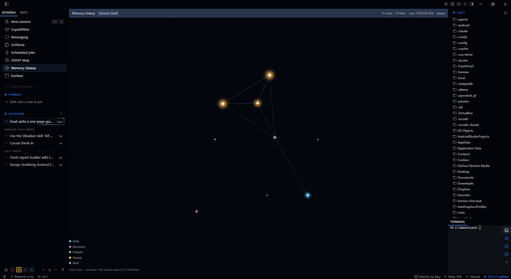
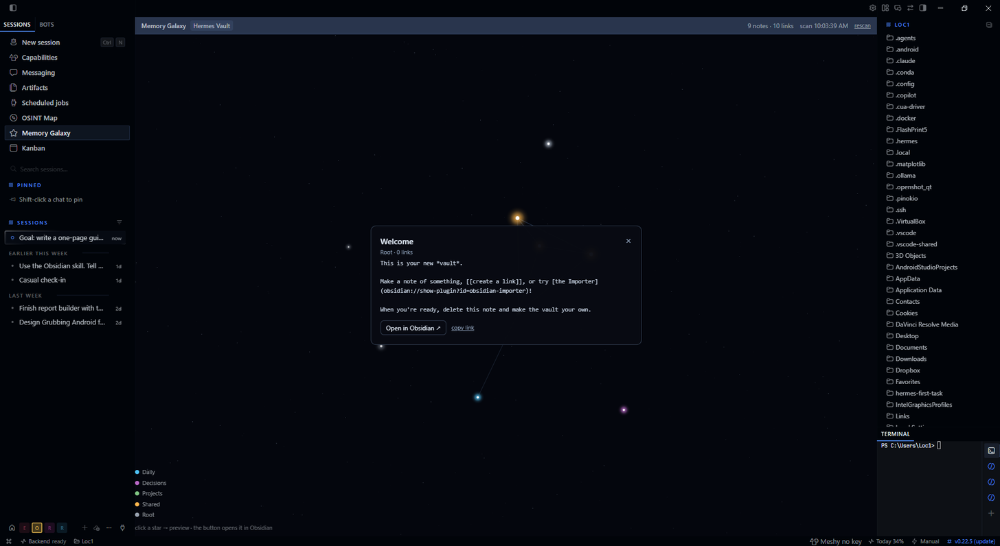
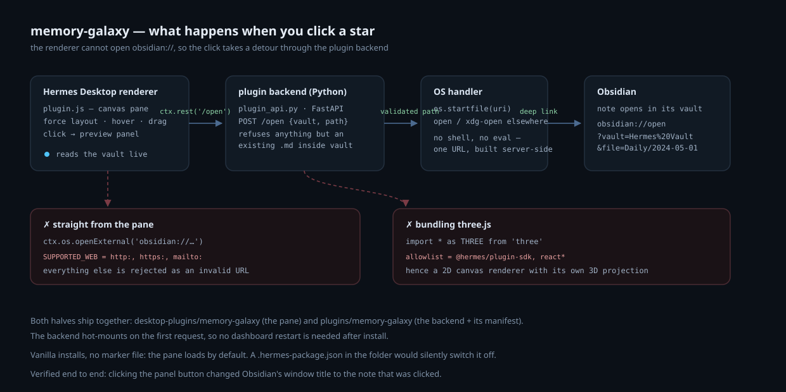

# memory-galaxy

A Hermes Desktop pane that renders an Obsidian vault as a live, force-directed star map: notes are
glowing stars, `[[wikilinks]]` are faint lines, newer notes burn brighter. Hover a star to see its
neighbours light up, drag stars to rearrange the sky, click one for a preview, and open the real note
in Obsidian with one button.





Built as a **Hermes Desktop plugin** — a sidebar row plus an in-app route — with a small Python
backend for the one thing the renderer is not allowed to do (launch `obsidian://`).

---

## Why this is more than a canvas

Three walls stand between a desktop pane and "click a star, open the note". Each one fails *silently*,
which is why they are worth writing down.



**1. The renderer may only open `http:`, `https:` and `mailto:`.** `electron/external-open.ts`
allowlists those three schemes (`SUPPORTED_WEB`) and rejects everything else as an invalid URL. So
`ctx.os.openExternal('obsidian://open?…')` fails, and a naive plugin just does nothing. The fix is a
plugin backend: the pane asks it over `ctx.rest`, the Python side validates the path and hands the
deep link to the OS.

**2. A desktop plugin may only import `@hermes/plugin-sdk` and `react*`.** Anything else — `three`,
a CDN URL, a dynamic `import()` — is refused at load with `unsupported imports`. That is why this
renders on a 2D canvas with its own perspective projection and a hand-rolled 3D force layout instead
of three.js. It also means the plugin is 17 KB, not 900 KB.

**3. A `.hermes-package.json` marker silently disables the plugin.** The marker means "desktop half of
an agent package", and the loader caps those to opt-in (`defaultEnabled: marker ? false : undefined`):
the plugin appears in the inventory and never registers, with no error anywhere. Hand-written plugins
must not carry it — and shipping a `desktop/` folder inside `plugins/<name>/` makes Electron recreate
it, so this repo's backend half deliberately has no `desktop/` directory.

## Install

Two halves, both under your Hermes home (`%LOCALAPPDATA%\hermes` on Windows, `~/.hermes` elsewhere).

```bash
HERMES_HOME="${HERMES_HOME:-$LOCALAPPDATA/hermes}"

# 1. the pane
cp -r desktop-plugins/memory-galaxy "$HERMES_HOME/desktop-plugins/"

# 2. the backend that can launch obsidian://
cp -r plugins/memory-galaxy "$HERMES_HOME/plugins/"
```

Then allow the backend to run: user plugins are inert until they are in `plugins.enabled` for the
profile the Desktop is using (`$HERMES_HOME/profiles/<profile>/config.yaml`, or `$HERMES_HOME/config.yaml`
for the default profile):

```yaml
plugins:
  enabled:
    - memory-galaxy
```

No restart is needed for the pane — the plugin root is watched and new folders load immediately — and
the backend mounts itself on the first request.

## Point it at your vault

```bash
cd desktop-plugins/memory-galaxy
./rebuild.sh /path/to/your/vault      # or set OBSIDIAN_VAULT_PATH
```

`rebuild.sh` rescans the vault into `src/graph.json` and rebundles `plugin.js`; Hermes Desktop hot-reloads
the file. Needs Node and either a local `esbuild` or `npx`. The shipped build embeds this repo's
`examples/vault`, so the pane draws a demo map until you run it against your own notes.

The pane then rescans the vault itself every 20 seconds (and on `rescan` / when the tab regains focus),
so new notes and links appear without rebuilding. The embedded graph is only the offline fallback.

## Using it

| Gesture | Result |
| --- | --- |
| hover a star | its neighbours light up, everything else dims |
| click a star | preview panel with the note's text |
| **Open in Obsidian ↗** | opens that note in Obsidian (via the backend) |
| copy link | puts the `obsidian://` deep link on your clipboard |
| drag a star | moves it in the plane at its own depth |
| drag empty space | orbits the camera |
| scroll | zoom |

Colours follow the top-level folder (`Daily`, `Decisions`, `Projects`, `Shared`, root notes), size
follows link count, brightness follows recency.

Positions are view state only: adding or removing a note re-runs the layout and the sky snaps back.
Nothing is written to the vault, and the plugin reads your notes locally — nothing leaves the machine.

## Troubleshooting

| Symptom | Cause |
| --- | --- |
| Sidebar row missing, no error | a `.hermes-package.json` in the folder (marker → opt-in), or a folder name that differs from the plugin id |
| `Plugin "memory-galaxy" failed to load: unsupported imports …` | something outside `@hermes/plugin-sdk` / `react*` got bundled |
| Button says "Obsidian did not accept the link" and the preview stays | the backend is not mounted — check the name is in `plugins.enabled` |
| Counts say `snapshot` instead of a scan time | the pane could not reach `window.hermesDesktop`; you are seeing the bundled fallback graph |
| Notes stopped updating | the pane was left on a note view; reopen it, or press `rescan` |

Renderer errors land in `$HERMES_HOME/logs/desktop.log` as `[renderer error:main]` — a successful
load is silent.

## Layout

```
desktop-plugins/memory-galaxy/
  plugin.js            built bundle (this is what Hermes loads)
  rebuild.sh           rescan a vault + rebundle
  src/memory-galaxy.jsx  pane: canvas renderer, force layout, drag, preview
  src/scan-vault.mjs     vault → graph.json scanner
  src/graph.json         embedded fallback graph
plugins/memory-galaxy/
  plugin.yaml                   agent-side manifest (no tools, no network)
  dashboard/manifest.json       declares `api: plugin_api.py`
  dashboard/plugin_api.py       POST /open → validates the note, launches the deep link
examples/vault/                 a six-note demo vault
docs/architecture.svg           the diagram above
```

## Verified

- Clicking **Open in Obsidian ↗** in the real panel changed Obsidian's window title to `Welcome - Hermes Vault`.
- Dragging is 1:1 with the cursor: a (80, 50) px pointer drag moves the star (80.00, 50.00) px, at constant depth.
- Live rescan: with a probe note added the pane logged `notes=10 links=12`, and back to `notes=9 links=10` after removing it.

## License

MIT — see [LICENSE](LICENSE). Not affiliated with Obsidian or Nous Research.
